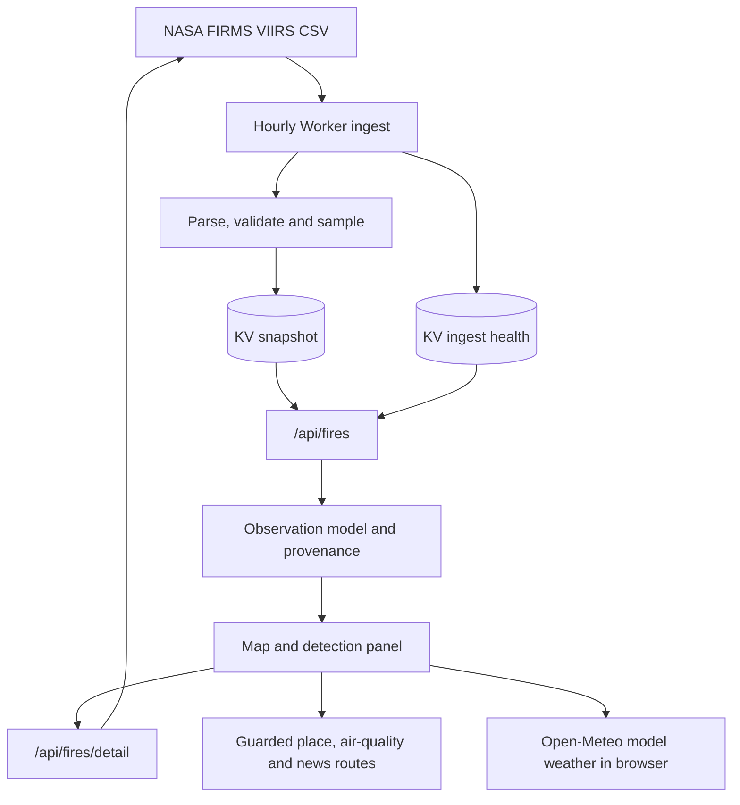

# WildfireWatch

A map for exploring selected NASA FIRMS satellite thermal detections, with source provenance, feed-health reporting and a detail view.

**Demo URL:** [wildfire-watch.duartemonteiro.workers.dev](https://wildfire-watch.duartemonteiro.workers.dev) · **Deployment:** configured for Cloudflare Workers through GitHub Actions.

**Data note:** a thermal detection is not a confirmed fire. Satellite data can arrive hours after acquisition. Operational status is unknown unless an authority reports it; area and other derived values are labelled as estimates. In an emergency, call 112.

[Operations](docs/operations.md) · [Compliance review](docs/compliance.md) · [Source code](src/lib/wildfire) · [Deployment workflow](.github/workflows/deploy.yml)

## Why it exists

Global satellite feeds are difficult to inspect quickly. The project turns selected observations into a navigable map while keeping source measurements, derived estimates and operational claims distinct. The detail panel shows the source, acquisition time and confidence category, alongside clearly labelled estimates and related context.

## How it works

An hourly Cloudflare Worker streams the worldwide three-day VIIRS feed, validates it and writes a processed snapshot plus a separate ingest-health record to KV. It replaces the last known-good snapshot only after a complete feed passes validation. The browser reads from the cache and does not wait for NASA.

The ingest keeps priority-region detections that pass its parsing and quality filters. It excludes low-confidence records, non-positive radiative power, and invalid coordinates or acquisition times. It reserves part of a capped sample for high-radiative-power detections worldwide, then spreads the remainder across a 2-degree grid. Overview counts describe this sample, not the entire FIRMS archive. Selecting a detection requests bounded, higher-resolution FIRMS data and supporting context through guarded routes.



Map clusters are for display. At detail zoom, the map draws detected sensor pixels; it does not claim a burned perimeter. A derived burned-area value is labelled as an estimate. The operational state stays `unknown` because the live adapter is FIRMS only.

## Engineering decisions

- **Separate snapshot freshness from ingest health.** The page can report a recent snapshot with a failed refresh, stale data, a stalled ingest or no usable snapshot.
- **Keep the last complete snapshot.** A partial or malformed worldwide feed does not replace known-good data.
- **Keep provenance with the dataset.** Every observation points to shared metadata for provider, product, instrument, source, retrieval and processing times.
- **Bound upstream work.** Detail boxes are snapped to a grid; coordinates and lookups are validated, cached and budgeted. The app does not spend a KV write for each visitor request.
- **Treat missing rendering support as a UI state.** MapLibre 6 requires WebGL2. If the browser cannot create a WebGL2 context, the app says the map is unavailable while keeping the detection panel and details available.
- **Respect the edge runtime.** The Cloudflare Worker build uses OpenNext and avoids Node built-ins in server code.

## Evidence and checks

The project uses four distinct sources of information:

1. **Observation:** VIIRS acquisition time, radiative power, source confidence and sensor-pixel geometry.
2. **Derived value:** map intensity bands, location enrichment and area estimates, labelled as inferred or estimated.
3. **Operational status:** unknown while only FIRMS supplies the live observations.
4. **Feed health:** separate status for the cached snapshot and the scheduled ingest.

[PR #3](https://github.com/WhiteBlindness/wildfire-watch/pull/3) integrated provenance, freshness, failure-safe snapshots, operational alerts and source safeguards. [PR #4](https://github.com/WhiteBlindness/wildfire-watch/pull/4) moved to patched MapLibre 6 and covered map behaviour. [PR #5](https://github.com/WhiteBlindness/wildfire-watch/pull/5) added a non-map fallback when WebGL2 is unavailable.

The PR #5 verification summary reports 173 unit checks, 21 static checks, type-checking, lint, a Cloudflare build, 19 end-to-end checks, a deployment dry run and zero production dependency advisories. Its WebGL2 fallback scenarios include a 390-pixel viewport, keyboard navigation, dark and light themes, feed failure and detection details. The PR reports WCAG 2.2 AA scans on the tested views; this is not an application-wide conformance claim.

## Run locally

Requirements: Node.js and npm. A NASA FIRMS map key is needed for live satellite data; configure `FIRMS_MAP_KEY` locally and do not commit it.

```bash
npm install
npm run dev
```

For offline interface work, the end-to-end setup runs a production build with a deterministic synthetic snapshot in local KV:

```bash
npm run build:cloudflare
node e2e/support/start-server.mjs
```

Run the documented checks:

```bash
npm test
npm run typecheck
npm run lint
npm run build:cloudflare
npm run test:e2e
```

The GitHub Actions workflow runs tests, type-checking, lint, the Cloudflare build and end-to-end checks for pull requests. It deploys `main` only after those gates pass. Cloudflare's separate Git integration is disconnected to avoid a second deploy path.

## Development timeline

- **31/07/2026:** authentic FIRMS telemetry and map interactions added in [commit `25c9b52`](https://github.com/WhiteBlindness/wildfire-watch/commit/25c9b52).
- **01/08/2026:** satellite sampling, clustering and the news parser added in [commit `35672fb`](https://github.com/WhiteBlindness/wildfire-watch/commit/35672fb).
- **03/08/2026:** global three-day ingestion and temporal map controls added in [commit `43a1b5d`](https://github.com/WhiteBlindness/wildfire-watch/commit/43a1b5d).
- **12/08/2026:** the map moved to VIIRS sensor geometry in [commit `0752566`](https://github.com/WhiteBlindness/wildfire-watch/commit/0752566).
- **03/10/2026:** source provenance, feed health and failure-safe ingestion integrated in [PR #3](https://github.com/WhiteBlindness/wildfire-watch/pull/3).
- **04/10/2026:** patched MapLibre 6 and the WebGL2 unavailable state integrated in [PR #4](https://github.com/WhiteBlindness/wildfire-watch/pull/4) and [PR #5](https://github.com/WhiteBlindness/wildfire-watch/pull/5).

Dates are commit or merge dates. They do not imply external operational acceptance.

## Current scope and limitations

- The live source is NASA FIRMS. EFFIS and ANEPC adapters are not implemented in `main`.
- A map point is a thermal observation, not confirmation that a fire is active, contained or extinguished.
- The map's sample and estimated area are not a complete incident register or operational severity assessment.
- The service depends on scheduled Cloudflare Workers, KV and upstream providers; a last-known-good snapshot can become stale when ingestion fails.
- The interactive map requires WebGL2. Without it, the map is unavailable, but the panel, list and details remain available.
- Weather, mapping and selected context providers contact the visitor's browser directly. The site has no accounts, advertising or analytics; see the [privacy page](https://wildfire-watch.duartemonteiro.workers.dev/privacidade) and [compliance review](docs/compliance.md).

## Privacy, accessibility and legal pages

The public site stores the visitor's language and theme in local storage and sets no analytics cookies. The browser contacts CARTO, Esri and Open-Meteo directly; the privacy page explains these requests. The app provides European Portuguese and English, keyboard access and an unavailable-map state when WebGL2 cannot run.

- `/sobre`: data meaning, sources, methodology and accessibility.
- `/privacidade`: privacy and cookie policy.
- `/termos`: terms of use.

The legal pages are project documentation, not a legal certification of every upstream source.
